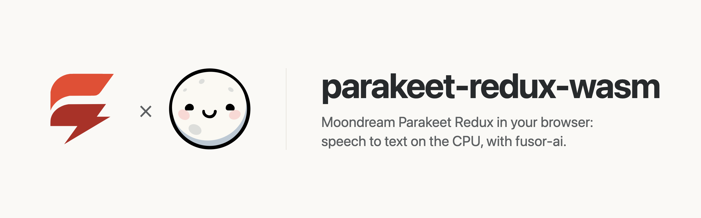
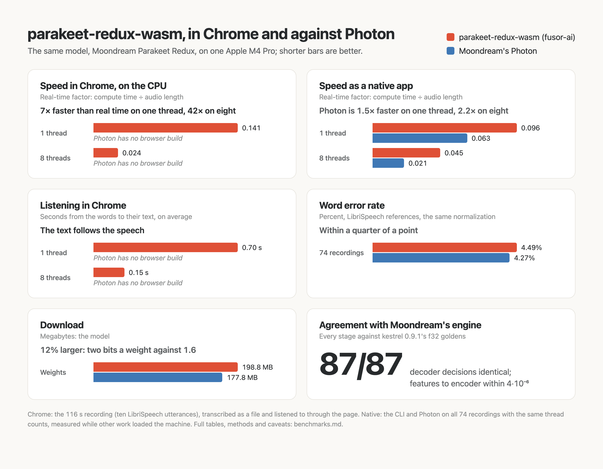

<p>
  <picture>
    <source media="(prefers-color-scheme: dark)" srcset="assets/brand/banner-dark.png">
    
  </picture>
</p>

# Speech to text in the browser, on the CPU

Speak, or pick a recording, and read what was said, transcribed by [Moondream Parakeet Redux](https://huggingface.co/moondream/parakeet-redux), a 1.58-bit version of NVIDIA's [parakeet-tdt-0.6b-v3](https://huggingface.co/nvidia/parakeet-tdt-0.6b-v3) for 25 European languages, computed on your own device. No server, no API key, no GPU required, and once the model has loaded, no audio leaves the page.

parakeet-redux-wasm is the app around the model: a [fusor](https://github.com/fusor-rs/fusor) page, the browser runtime and a native CLI. The model itself, compiled to WebAssembly, is built with [fusor-ai](https://github.com/fusor-rs/fusor-ai), the toolkit for AI runtimes in Rust and WebAssembly, from the published weights.

**In development · v0.1**: this is experimental software. See [status and known limitations](#status-and-known-limitations).

[Run it](#run-it-locally) · [Try it online](#try-it-online) · [How it works](#how-it-works) · [How fast is it](#how-fast-is-it) · [Benchmarks](benchmarks.md) · [Status](#status-and-known-limitations) · [Contributing](CONTRIBUTING.md)

## Run it locally

You need Rust 1.99 or newer, installed with [rustup](https://rustup.rs), Node.js 22 or newer and [`just`](https://github.com/casey/just). Then:

```sh
git clone --recurse-submodules https://github.com/fusor-rs/parakeet-redux-wasm && cd parakeet-redux-wasm
just ui
```

and open the address it prints. That's all: `just ui` installs the pinned tools (the threads toolchain with rustup; wasm-bindgen, binaryen and the fusor CLI into `.tools/`), downloads the checkpoint at a pinned revision (178 MB, each file sha256-checked), compiles it into a 199 MB bundle, builds the four browser runtimes (a few minutes the first time, seconds after) and the page, and serves it on `http://localhost:8787` with the bundle beside it.

Press **Listen**, even while the model is still loading: the audio is kept and transcribed the moment the model is ready. The words appear as you speak; the latest ones are provisional, shown lighter, until a pause makes them final. **Transcribe a file** reads any recording the browser can decode, cut at its pauses into segments of at most 30 s. Every run is measured live: the real-time factor, the delay from audio to its text, the audio transcribed, the words, and the network requests since the model loaded, which stay at zero.

## Try it online

Open [parakeet-stt.fusor.build](https://parakeet-stt.fusor.build) in Chrome or Edge. The page downloads the 199 MB model once and keeps it in the browser's storage, so the next visit loads in under a second. The same page runs as a Hugging Face Space, [fusorlabs/parakeet-redux-wasm](https://huggingface.co/spaces/fusorlabs/parakeet-redux-wasm).

## More ways to run it

### Build everything from source

```sh
just build    # also downloads the checkpoint (178 MB, sha256-checked) and compiles the bundle
just serve
```

`CHECKPOINT=<dir>` reuses a checkpoint you already have, and `PROFILE=f32` compiles the 2.5 GB full-precision bundle that `just parity` checks against the reference.

### The CLI

The CLI transcribes 16 kHz WAV files without a browser:

```sh
target/release/parakeet transcribe dist/model speech.wav
target/release/parakeet transcribe dist/model meeting.wav interview.wav
```

`parakeet bench` measures each stage on a recording and `parakeet parity` compares every stage with the reference's outputs.

## How it works

- **The model runs in your tab.** The runtime is Parakeet Redux compiled to WebAssembly with fusor-ai: normalized log-mel features every 10 ms, a convolutional subsampler that folds them into one frame per 80 ms, 24 FastConformer layers with relative-position attention, and a token-and-duration transducer that reads off each frame a token (or nothing) and how many frames to skip.
- **Ternary all the way down.** Every one of the encoder's 604 million projection weights is −1, 0 or +1 with a scale per 128. The bundle keeps them that way, two bits each (fusor-ai's `T2b128` format), and the matrix multiply unpacks them in SIMD registers and adds up each group's int8 products as integers before one scaling. The other large matrices are stored in 7 bits.
- **Live by re-reading, final at pauses.** While you speak, the audio not yet final is transcribed again whenever half a second more has arrived. Once 8 s are pending, the audio up to the middle of their last pause, found by the model's own speech head, becomes a segment of its own: transcribed once more, final, never read again.
- **Long recordings are cut at pauses**, as Moondream's Photon cuts them: the speech head marks speech in blocks of two minutes, and each cut falls in the middle of the last pause before 30 s.
- **Audio never touches the main thread.** The microphone runs in a 16 kHz AudioContext whose capture worklet posts the samples straight to the engine worker; the page only draws the waveform and the text.
- **Threads and SIMD where the browser has them.** The page picks one of four builds: worker threads when it is cross-origin isolated, relaxed SIMD when the engine supports it, plain SIMD128 everywhere else.
- **Downloaded once, verified always.** The bundle streams in parts, each checked against its BLAKE3 hash, and stays in the browser's origin-private storage, so the next visit loads from this device in a fraction of a second.
- **Sealed.** The runtime imports no network, storage, clock or entropy capability; fusor-ai's import check proves it on every build. The page counts its network requests while it transcribes, and the count is zero.
- **A fusor page.** Listening, the file, the transcript and the measurements are Rust signals with HTML templates; a small JavaScript module runs the engine worker, the microphone and the file decoding.

## How fast is it

On an Apple M4 Pro in Chrome, the page transcribes a 116 s recording in 3.0 s on eight threads and in 16.6 s on one: 42× and 7× faster than real time, at a word error rate of 4.7%. Listening to it, the text follows the speech by 0.15 s on average on eight threads and by 0.7 s on one. Every stage agrees with Moondream's own engine within 4·10⁻⁶, and all 87 decoder decisions of the test utterance are the same. [benchmarks.md](benchmarks.md) has the full measurements, in Chrome, in Node and natively against Moondream's [Photon](https://moondream.ai/photon), including the ones where we lose:

<picture>
  <source media="(prefers-color-scheme: dark)" srcset="assets/benchmarks/benchmarks-dark.png">
  
</picture>

The real-time factor (RTF) is compute time over audio time: lower is faster. Moondream's model card quotes the inverse, seconds of audio per second. Natively, Photon is faster, 1.5× on one thread and 2.2× on eight, measured while other work loaded the machine, which slows our spinning thread team more: both multiply with the CPU's int8 dot-product instructions (`sdot`), and Photon's native kernels get more out of them than ours, which are built for WebAssembly first.

## Documentation

| Guide | Covers |
| --- | --- |
| [Benchmarks](benchmarks.md) | Speed, delay, word error rate, download and agreement with Moondream's engine, and how to reproduce them |
| [Contributing](CONTRIBUTING.md) | Setup, checks, moving fusor-ai, deploying |
| [AGENTS.md](AGENTS.md) | The code standard every change follows |

## Status and known limitations

parakeet-redux-wasm is v0.1 and experimental.

### Platform status

| Platform or capability | Status |
| --- | --- |
| Chrome and Edge, threads and relaxed SIMD | Headless Chrome end-to-end check (`just e2e`): listen while loading, live transcript, a file, revisit |
| Browsers without relaxed SIMD (Safari, older Firefox) | SIMD128 builds, checked in Node (`just smoke`); not tested in those browsers |
| Pages without cross-origin isolation | Single-threaded builds, about 7× faster than real time on an Apple M4 Pro, live included |
| Native CLI (macOS on Apple silicon) | Built and measured; no release archives yet |
| Phones | Not measured; the threaded builds' memory may grow to 2 GB |

**Not supported yet:**

- Listening in browsers other than Chrome and Edge: not tested.
- Word timestamps on the page (the CLI and the runtime have them per sentence and per word).
- A GPU backend.
- A streaming encoder: live transcription re-reads the audio that is not final yet.

The model is CC-BY-4.0: [Moondream Parakeet Redux](https://huggingface.co/moondream/parakeet-redux), based on NVIDIA's [parakeet-tdt-0.6b-v3](https://huggingface.co/nvidia/parakeet-tdt-0.6b-v3). The fixed recordings are LibriSpeech dev-clean utterances (CC-BY-4.0).

## How is this different from Moondream's Photon?

[Photon](https://moondream.ai/photon) is Moondream's own runtime for the model: a Python package with native kernels for x86, ARM and Apple GPUs. parakeet-redux-wasm is a separate implementation on fusor-ai: the same weights, its own kernels, frontend and decoder, with every stage checked against Photon's engine, running in the browser. Natively, Photon is faster; it has no browser build.

## How is this different from a cloud speech-to-text API?

A cloud API sends your audio to a server and bills per minute. parakeet-redux-wasm runs on your device after a one-time download: it works offline, costs nothing per recording, and your audio never leaves the page.

## Contributing

parakeet-redux-wasm is an open source project in early development. The [contributing guide](CONTRIBUTING.md) covers the setup, checks and workflow. The runtime and the CLI live in `crates/` and the page in `app/`; the model and its toolkit come from fusor-ai, its crates and browser scripts from the `vendor/fusor-ai` submodule.

parakeet-redux-wasm is built with the help of AI tools, mainly Claude Code, under the same rules the project asks of contributors: see [Using AI tools](CONTRIBUTING.md#using-ai-tools).

## License

Licensed under the [MIT License](LICENSE).
